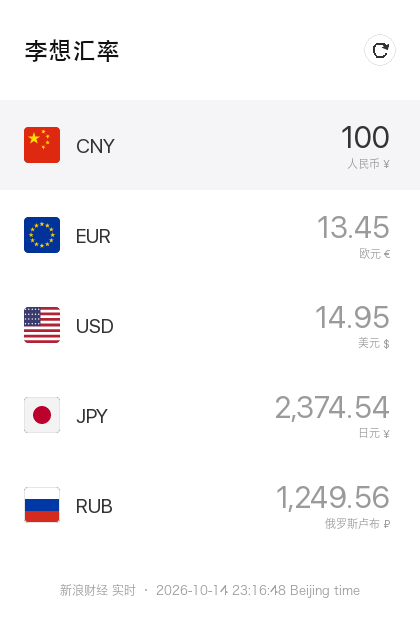

# Exchange Rate

Two small Python tools for EUR / CNY (RMB) / USD / JPY / RUB exchange rates:

| File | What it is |
| --- | --- |
| `exchange_rate.py` | Command-line script: prints EUR → RMB, JPY, USD |
| `exchange_rate_app.py` | 李想汇率 — a pygame currency converter (CNY, EUR, USD, JPY, RUB) |

`exchange_rate_app.py` imports the rate functions from `exchange_rate.py`, so keep both files in the same folder.

## Setup

```bash
activep3            # source $HOME/.venvs/p3env/bin/activate
pip install pygame  # only needed for the app; the script uses the standard library only
```

## exchange_rate.py — command line

```bash
python exchange_rate.py                      # 1 EUR, ECB rates
python exchange_rate.py 250                  # convert 250 EUR
python exchange_rate.py --source sina        # real-time market rates from Sina
python exchange_rate.py --date 2024-01-15    # historical ECB rates (ECB only)
```

Example output:

```
Exchange rates for 1.00 EUR (ECB, 2026-10-14):
  RMB          7.4925   (1 EUR = 7.4925 CNY)
  JPY        177.3900   (1 EUR = 177.39 JPY)
  USD          1.1195   (1 EUR = 1.1195 USD)
```

| Option | Description |
| --- | --- |
| `amount` | Amount in EUR, default `1` |
| `--source ecb\|sina` | Rate source, default `ecb` |
| `--date YYYY-MM-DD` | Historical date, default `latest`; only works with `--source ecb` |

On a network or API error it prints a message and exits with status 1.

## exchange_rate_app.py — 李想汇率

```bash
python exchange_rate_app.py
```



Opens with 100 CNY. Pick a currency row and type an amount; all the other rows convert as you type.

| Action | How |
| --- | --- |
| Select a currency | Click a row, or `↑` / `↓` (`Tab` also moves down) |
| Type an amount | `0`–`9` and `.`; the first key after switching rows replaces the value |
| Delete | `Backspace` |
| Refresh rates | Click ⟳, or press `R` (also automatic every 60 seconds) |
| Quit | `Esc` or close the window |

The bottom line shows the rate source and its timestamp. Rates are fetched in the background, so the window never freezes on a slow network.

## Rate sources

| Source | Updated | Used by | Notes |
| --- | --- | --- | --- |
| [Frankfurter](https://frankfurter.dev) (ECB) | Once per working day, ~16:00 CET | Script (default) | Official ECB reference rates, history back to 1999, **no RUB** |
| [Sina Finance](https://finance.sina.com.cn) `hq.sinajs.cn` | Every few seconds | App (primary), script `--source sina` | Real-time market quotes; unofficial endpoint, see below |
| [open.er-api.com](https://www.exchangerate-api.com/docs/free) | Once per day | App (fallback) | Free, includes RUB |

All three are free and need no API key. Daily and real-time rates differ because the market moves during the day. None of them are the rates a bank will give you when you exchange money.

**About Sina:** `hq.sinajs.cn` is the internal feed behind Sina's own pages, not a public API. It only answers requests with a `Referer: https://finance.sina.com.cn` header, which the script sends. It has no documentation or guarantees and may change or stop working at any time; if it fails, the app falls back to open.er-api automatically. Fine for personal use, but don't rely on it for anything shared or commercial.

## Notes

- RMB's official currency code is **CNY**, which is what the APIs use.
- The app uses macOS system fonts (SF for numbers, Hiragino Sans GB for Chinese). On other systems it falls back to any installed CJK font.
- The flags are drawn in code, so there are no image files.
