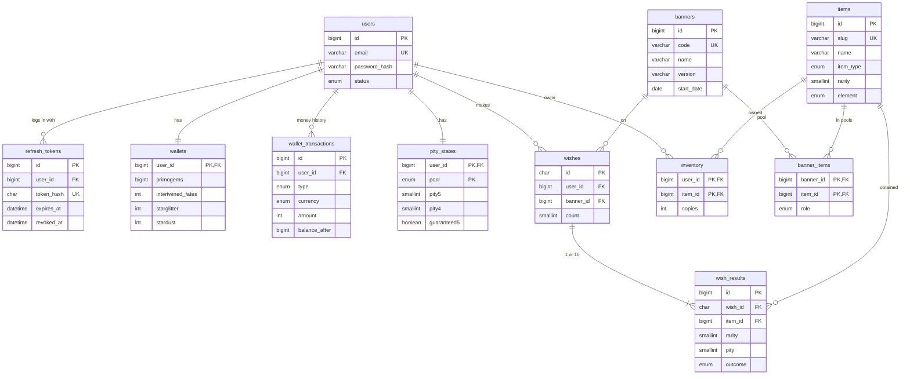

# Database design — step by step

The database of the Genshin Impact pull simulator (`../pull_simulator`), rebuilt by hand in
plain SQL, one lesson step per file. Each file explains in its comments what it creates and why.

The tables are the same as the ones the app gets from its Alembic migration (same columns,
types, keys, indexes and foreign keys; only the constraint names are more readable here), and
the data is generated from the same `pull_simulator/data/*.json`.

## Run it

MySQL 8 runs in Docker (`../pull_simulator/script/dev/docker-db.sh` starts it). Everything goes
into a separate database, `genshinwish_lesson`: the app's own data is never touched.

```sh
./run.sh                    # all steps, 00 to 11, in order
./run.sh 02_catalogue.sql   # one step (or several)
./run.sh --shell            # a mysql prompt inside genshinwish_lesson
./run.sh 99_drop_all.sql    # drop every table
```

Any MySQL client works too (DBeaver, DataGrip, MySQL Workbench): `localhost:3308`, user `root`,
password `root`.

## The steps

| Step | File                     | Builds                                   | Concepts |
|------|--------------------------|------------------------------------------|----------|
| 0    | `00_create_database.sql` | the database and its user                | character set, collation, users and rights |
| 1    | `01_accounts.sql`        | `users`, `refresh_tokens`                | primary key, AUTO_INCREMENT, NOT NULL, UNIQUE, ENUM, DEFAULT, foreign key, ON DELETE CASCADE |
| 2    | `02_catalogue.sql`       | `items`, `banners`, `banner_items`       | many-to-many join table, composite key, data on a relation |
| 3    | `03_wallet.sql`          | `wallets`, `wallet_transactions`         | one-to-one, current state vs. append-only ledger, index |
| 4    | `04_pity.sql`            | `pity_states`                            | composite key, BOOLEAN |
| 5    | `05_wishes.sql`          | `wishes`, `wish_results`                 | UUID key, header / lines (one-to-many), denormalisation, composite indexes |
| 6    | `06_inventory.sql`       | `inventory`                              | store or compute? (constellation) |
| 7    | `07_seed_items.sql`      | 83 characters and weapons                | multi-row INSERT, escaping quotes, UPDATE with CONCAT, GROUP BY |
| 8    | `08_seed_banners.sql`    | 6 banners and their item pools           | INSERT … SELECT, joins that pair every row with every row |
| 9    | `09_seed_test_user.sql`  | `traveler@test.local` with wallet, pity  | upsert (ON DUPLICATE KEY UPDATE), INSERT IGNORE, session variables |
| 10   | `10_transactions.sql`    | a top-up, buying fates, one wish         | START TRANSACTION / COMMIT / ROLLBACK, SELECT … FOR UPDATE |
| 11   | `11_queries.sql`         | the query behind each page               | joins, pagination, aggregates, CASE, conditional aggregation, EXPLAIN, subquery |
| —    | `99_drop_all.sql`        | removes everything                       | drop order and foreign keys |

Steps 1 to 6 create the tables in dependency order: a table is created after every table its
foreign keys point at.

## The tables



Three groups:

- **Catalogue** (`items`, `banners`, `banner_items`): what can be pulled. Written once, then
  only read.
- **Accounts** (`users`, `refresh_tokens`): who plays.
- **Player state** (`wallets`, `wallet_transactions`, `pity_states`, `wishes`, `wish_results`,
  `inventory`): everything that changes when a player tops up or pulls. One wish changes five
  of them at once, inside one transaction (step 10).

## Where the app does the same

| Here                       | In the app |
|----------------------------|------------|
| steps 1–6                  | `pull_simulator/migrations/versions/0001_initial_schema.py` (Alembic), from the models in `pull_simulator/app/models/` |
| steps 7–8                  | `pull_simulator/app/tools/seed_catalog.py` reading `pull_simulator/data/*.json` |
| step 9                     | `pull_simulator/script/dev/seed-test-users.sql` |
| step 10                    | `pull_simulator/app/services/wallet_service.py`, `wish_service.py` |
| step 11                    | `pull_simulator/app/services/history_service.py`, `catalog_service.py`, `inventory_service.py` |

Steps 7 and 8 are generated: after changing `pull_simulator/data/*.json`, run
`python3 generate_seed_sql.py` to rewrite them.
